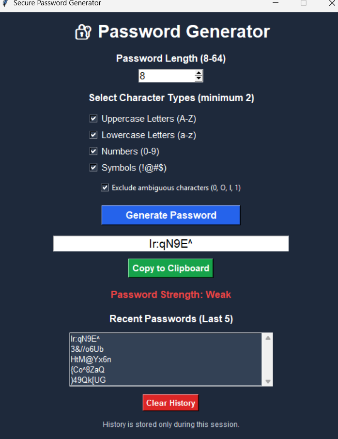

# 🔐 Password Generator

A secure and user-friendly Password Generator built using Python and Tkinter. This application generates strong random passwords using Python's `secrets` module.

## ✨ Features

- Generate secure random passwords.
- Customize password length (8–64 characters).
- Choose uppercase letters, lowercase letters, numbers, and symbols.
- Exclude ambiguous characters (0, O, l, 1).
- Password strength indicator (Weak, Medium, Strong).
- Automatically copy generated passwords to the clipboard.
- View the last 5 generated passwords.
- Clear password history.
- Input validation and error handling.

## 🛠️ Technologies Used

- Python
- Tkinter
- Secrets
- String
- Pyperclip

## 📦 Installation

1. Clone the repository:

   ```bash
   git clone https://github.com/PunitPatil1029/Password_Generator.git
   ```

2. Open the project folder:

   ```bash
   cd Password_Generator
   ```

3. Install the required package:

   ```bash
   pip install pyperclip
   ```

4. Run the application:

   ```bash
   python main.py
   ```

## 🚀 How to Use

1. Select the desired password length.
2. Choose at least two character types.
3. Enable or disable ambiguous character exclusion.
4. Click **Generate Password**.
5. View the generated password and its strength.
6. The password is automatically copied to your clipboard.

## 🔒 Security

This application uses Python's `secrets` module for cryptographically strong random password generation. Password history is stored only during the current application session.

## 📸 Application Screenshot



## 👨‍💻 Author

**Punit Patil**

GitHub: https://github.com/PunitPatil1029

---

*Developed as part of the OASIS INFOBYTE Python Programming Internship.*